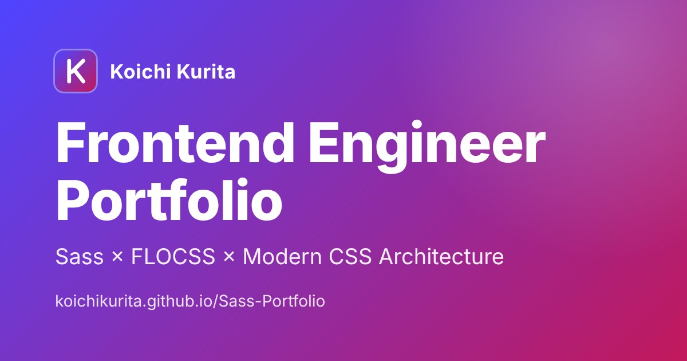
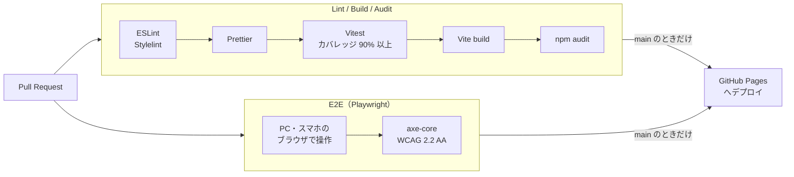

# Sass Portfolio

[](https://github.com/KoichiKurita/Sass-Portfolio/actions/workflows/ci.yml)

Sass（ITCSS × FLOCSS）と Vite で構築した、フロントエンドエンジニアのポートフォリオサイトです。
見た目だけでなく、**セキュリティ・アクセシビリティ・テスト・CI/CD** まで、実務で求められる品質を意識して作っています。

🔗 **公開サイト**：https://koichikurita.github.io/Sass-Portfolio/



---

## 目次

- [主な機能](#主な機能)
- [技術スタック](#技術スタック)
- [アーキテクチャ](#アーキテクチャ)
- [品質保証](#品質保証)
- [セキュリティ](#セキュリティ)
- [アクセシビリティ](#アクセシビリティ)
- [パフォーマンス](#パフォーマンス)
- [設計判断の記録](#設計判断の記録)
- [開発フロー](#開発フロー)
- [セットアップ](#セットアップ)
- [今後の課題](#今後の課題)

---

## 主な機能

### タスク管理アプリ（[/task/](https://koichikurita.github.io/Sass-Portfolio/task/)）

| 機能                     | 内容                                                                        |
| ------------------------ | --------------------------------------------------------------------------- |
| タスクの追加・完了・削除 | Enter キーでも追加できる。完了・削除はキーボードだけで操作できる            |
| 絞り込み                 | すべて / 未完了 / 完了済み                                                  |
| 保存                     | localStorage に保存。読み込み時にデータを検証し、壊れたデータでも停止しない |
| 読み上げ                 | 追加・完了・削除の結果をスクリーンリーダーに伝える（ライブリージョン）      |

### サイト全体

- ダーク / ライトテーマ：OS の設定に従い、選んだテーマは保存。表示前に反映するのでちらつかない
- スクロールに合わせたフェードイン：**JavaScript を使わず CSS だけで実装**（JS が動かなくても表示が崩れない）
- 「視差効果を減らす」設定への対応、スキップリンク、キーボード操作時のフォーカス表示
- OGP・favicon・canonical の整備

---

## 技術スタック

| 分類                    | 技術                                                             |
| ----------------------- | ---------------------------------------------------------------- |
| マークアップ / スタイル | HTML, Sass（`@use` / `@forward`）, ITCSS, FLOCSS + BEM, CSS 変数 |
| スクリプト              | JavaScript（ES Modules）                                         |
| ビルド                  | Vite 8（自作プラグイン 2 つ）                                    |
| テスト                  | Vitest 5, jsdom, カバレッジ（v8）, Playwright（E2E）, axe-core   |
| 静的解析・整形          | ESLint, Stylelint（standard-scss）, Prettier                     |
| Git フック              | husky 9, lint-staged                                             |
| CI/CD                   | GitHub Actions → GitHub Pages                                    |
| 依存関係の管理          | Dependabot（npm / GitHub Actions）                               |
| 実行環境                | Node.js 24（`.nvmrc` で固定）                                    |

---

## アーキテクチャ

### CSS：ITCSS × FLOCSS

CSS を「影響範囲の広いもの」から「狭いもの」の順に 7 つのレイヤーに分け、上から順に読み込みます。
後のレイヤーほど対象が限定されるため、**詳細度の衝突や、変更の影響範囲が予測できない状態**を防げます。

| レイヤー   | ディレクトリ  | 役割                                       | 例                                        |
| ---------- | ------------- | ------------------------------------------ | ----------------------------------------- |
| Settings   | `settings/`   | 変数・デザイントークン                     | 色、テーマごとの CSS 変数                 |
| Tools      | `tools/`      | ミックスイン（CSS を出力しない）           | `respond()`, `auto-grid()`, `light-theme` |
| Generic    | `generic/`    | リセット、全体の設定                       | リセット CSS、`prefers-reduced-motion`    |
| Elements   | `elements/`   | HTML 要素そのもの                          | `body`, `h1`, `:focus-visible`            |
| Objects    | `objects/`    | レイアウトの骨組み（`l-`）                 | `l-header`, `l-footer`                    |
| Components | `components/` | 部品（`c-`）とページ固有のまとまり（`p-`） | `c-card`, `p-task`                        |
| Utilities  | `utilities/`  | 1 つの役割だけを持つ補助クラス（`u-`）     | `u-visually-hidden`                       |

- クラス名は **FLOCSS の接頭辞 + BEM**（例：`c-card__title--large`）。Stylelint の正規表現でルールを強制しています。
- 色は **デザイントークン**（`--color-surface` など役割の名前を付けた CSS 変数）で管理し、テーマごとの値は `settings/_theme.scss` の 1 か所にまとめています。

### JavaScript：責務ごとにモジュールを分割

```text
src/js/task/
├── state.js    状態（タスクの一覧・絞り込み条件）を持つ
├── storage.js  localStorage への保存・読み込みと、データの検証
├── ui.js       状態から DOM を組み立てる（textContent のみ使用）
├── app.js      イベントと上の 3 つを結び付ける（initTaskApp）
└── index.js    エントリーポイント（initTaskApp を呼ぶだけ）
```

処理を関数として export し、`document` や `window` を引数で受け取れるようにしているため、
ブラウザがなくてもユニットテストで動作を確認できます。

---

## 品質保証

### 3 段構えのチェック

| タイミング | 内容                                                              | 仕組み                        |
| ---------- | ----------------------------------------------------------------- | ----------------------------- |
| 保存時     | ESLint / Stylelint の自動修正、Prettier の整形                    | VS Code の設定（`.vscode/`）  |
| コミット時 | 変更したファイルだけ lint・整形                                   | husky + lint-staged           |
| push 時    | ユニットテスト                                                    | husky                         |
| PR 時      | すべてのチェックと E2E テスト（通らないと main にマージできない） | GitHub Actions + ブランチ保護 |

### CI / CD



- PR でも CI を実行し、**品質ゲートを通らないものはマージもデプロイもされない**
- 2 つのジョブは並行して実行するため、E2E を追加しても待ち時間はほとんど増えない
- 権限は最小限（既定は読み取り専用。デプロイのジョブだけ書き込みを許可）
- 公式アクション（`actions/deploy-pages`）と OIDC でデプロイし、長期間有効なシークレットを使わない

### テスト

| 種類                 | ツール                     | 件数                            | 内容                                                                                                        |
| -------------------- | -------------------------- | ------------------------------- | ----------------------------------------------------------------------------------------------------------- |
| ユニットテスト       | Vitest + jsdom             | 68 件                           | 状態管理、データ検証、DOM の描画、イベント処理、テーマ、ビルドプラグイン                                    |
| E2E テスト           | Playwright                 | 33 件（PC 17 件・スマホ 16 件） | キーボード操作とフォーカス、テーマの保存と OS への追従、スキップリンク、JS 無効時の表示、CSP 違反がないこと |
| アクセシビリティ検査 | axe-core（E2E の中で実行） | 上記に含む                      | ダーク / ライト × 2 ページを WCAG 2.2 AA の基準で検査                                                       |

- ユニットテストのカバレッジ：行 100% / 分岐 97.8% / 関数 100%（しきい値 90% を下回ると CI が失敗）
- E2E テストは、本番と同じビルド結果（`vite preview`）を実際のブラウザで操作する。CSP など本番ビルドだけに入る設定も含めて確認できる
- 要素は CSS のクラス名ではなく、**スクリーンリーダーが読み上げる「役割」と「名前」**（`getByRole`）で探す。役割や名前が正しくなければテストが失敗するため、テストを書くこと自体がアクセシビリティの確認になる

XSS の修正やデータ検証などは**回帰テスト**として残しています。
たとえば `ui.js` を修正前の `innerHTML` を使った実装に戻すと、XSS のテストを含む 6 件が失敗します。

---

## セキュリティ

XSS に対して、入力・出力・実行の 3 層で防御しています（多層防御）。

| 層   | 対策                                                                                                              |
| ---- | ----------------------------------------------------------------------------------------------------------------- |
| 入力 | localStorage から読み込んだデータを 1 件ずつ検証し、必要な項目だけを取り出す                                      |
| 出力 | ユーザーの入力は `textContent` で描画し、HTML として解釈させない                                                  |
| 実行 | **CSP** と **Trusted Types** で、注入されたスクリプトやスタイルの実行・`innerHTML` への代入をブラウザに禁止させる |

その他の対策：

- `referrer-policy: strict-origin-when-cross-origin`（他サイトへ URL のパスを送らない）
- Dependabot による依存関係の自動更新と、CI での `npm audit`
- Dependabot の `cooldown`：公開直後のバージョンをすぐに取り込まない（乗っ取られたパッケージの混入対策）

> [!NOTE]
> GitHub Pages は HTTP レスポンスヘッダーを設定できないため、CSP は `<meta>` で指定しています。
> そのため `frame-ancestors`（クリックジャッキング対策）と違反レポートは使えません。
> 本番のサービスであれば、CDN（CloudFront、Cloudflare など）のレスポンスヘッダーで設定します。

---

## アクセシビリティ

WCAG 2.2 AA を目標にしています。axe-core による自動検査を **E2E テストとして CI で毎回実行**しており、ダーク / ライト × 2 ページのすべてで違反 0 件です。違反があると PR をマージできません。

| 対応           | 内容                                                                                                                           |
| -------------- | ------------------------------------------------------------------------------------------------------------------------------ |
| キーボード操作 | すべての操作をキーボードだけで行える。再描画後もフォーカスを失わない                                                           |
| 読み上げ       | `label`、`aria-label`、`aria-pressed`、ライブリージョン（`role="status"`）                                                     |
| 構造           | `main` などのランドマーク、スキップリンク                                                                                      |
| 見た目         | コントラスト比 4.5 以上（白い文字を載せるグラデーションは 5.8 以上）、`:focus-visible` によるフォーカス表示、削除ボタンは 44px |
| 動き           | `prefers-reduced-motion` のときはアニメーションを止める                                                                        |

自動検査で見つけられるのは問題の一部だけなので、キーボードだけでの操作（フォーカスの移動を含む）も E2E テストで確認しています。

---

## パフォーマンス

[PageSpeed Insights](https://pagespeed.web.dev/) で公開サイトを測定（Lighthouse 13.6、2026 年 11 月 27 日）。

| ページ     | 端末         | Performance | Accessibility | Best Practices | SEO |
| ---------- | ------------ | :---------: | :-----------: | :------------: | :-: |
| トップ     | モバイル     |     100     |      100      |      100       | 100 |
| トップ     | デスクトップ |     100     |      100      |      100       | 100 |
| タスク管理 | モバイル     |     100     |      100      |      100       | 100 |
| タスク管理 | デスクトップ |     100     |      100      |      100       | 100 |

| 指標                          | トップ（モバイル） | トップ（デスクトップ） | タスク管理（モバイル） | タスク管理（デスクトップ） |
| ----------------------------- | :----------------: | :--------------------: | :--------------------: | :------------------------: |
| LCP（最大のコンテンツの表示） |       0.8 秒       |         0.2 秒         |         0.8 秒         |           0.2 秒           |
| CLS（レイアウトのずれ）       |         0          |           0            |           0            |             0              |
| TBT（操作できない時間）       |        0 ms        |          0 ms          |          0 ms          |            0 ms            |

モバイルは、Moto G Power 相当の端末と低速 4G 回線を再現した条件での測定です。主な工夫：

- スクロール演出を **CSS のスクロール駆動アニメーション**（`animation-timeline: view()`）で実装し、IntersectionObserver を削除
- 外部フォントや外部スクリプトを使わない
- OGP 画像は JPEG で 59KB に圧縮（PNG だと 778KB）
- スクロールイベントに `{ passive: true }` を指定

> [!NOTE]
> PageSpeed Insights は「レンダリングをブロックしているリクエスト」として `theme-init.js` を挙げます。
> これは、保存済みのテーマを描画前に反映して**画面のちらつきを防ぐために、意図的に同期で読み込んでいる**ものです（[設計判断の記録](#設計判断の記録)を参照）。

---

## 設計判断の記録

実装の途中で検討したことと、その理由です。

| テーマ                 | 判断                                                                    | 理由                                                                                                                                         |
| ---------------------- | ----------------------------------------------------------------------- | -------------------------------------------------------------------------------------------------------------------------------------------- |
| フェードイン           | JS（IntersectionObserver）から CSS のスクロール駆動アニメーションに変更 | JS で表示していたため、**JS が失敗するとページが真っ白になっていた**。非対応ブラウザでは演出なしで表示する（プログレッシブエンハンスメント） |
| テーマの初期化         | `public/theme-init.js` を `<head>` で同期的に読み込む                   | module のスクリプトは HTML の解析後に実行されるため、画面がちらつく。CSP でインラインスクリプトを禁止しているので、別ファイルにした          |
| CSP の適用範囲         | 自作の Vite プラグインで、本番ビルドのときだけ `<meta>` を追加          | 開発サーバーは HMR のためにインラインのスタイルを使うため                                                                                    |
| `.env` のコミット      | 公開してよい設定は `.env`、秘密情報は `.env.local`                      | `VITE_` で始まる変数はブラウザに公開されるため、そもそも秘密情報を入れる場所ではない。CI でも同じ値を使える                                  |
| 環境変数の置き換え漏れ | 自作プラグインでビルドを失敗させる                                      | Vite は警告を出すだけでビルドが成功し、壊れた OGP の URL が気づかれずに公開されるため（Fail Fast）                                           |
| タスクの ID            | `Date.now()` から「最大の ID + 1」に変更                                | テストを書いたところ、**同じミリ秒に 2 件追加すると ID が重複する**バグが見つかった                                                          |

---

## 開発フロー

- **GitHub Flow**：`main` と短命な作業ブランチ（`fix/12-xss` のように Issue 番号を含める）
- **Issue / マイルストーン**で作業を管理し、「1 Issue = 1 PR」で Squash マージ
- コミットメッセージは **Conventional Commits**（`feat:` / `fix:` / `ci:` / `test:` など）
- `main` はブランチ保護で、PR 経由かつ CI の成功を必須にしている

| マイルストーン | 内容                                                                              |
| -------------- | --------------------------------------------------------------------------------- |
| M0             | 開発環境・運用ルール（Node のバージョン固定、EditorConfig、改行コードの統一など） |
| M1             | バグ修正・セキュリティ（マルチページのビルド、XSS、データ検証など）               |
| M2             | CI/CD・品質保証（GitHub Actions、Dependabot、Vitest、husky、Stylelint）           |
| M3             | セキュリティ強化・UX・a11y（CSP、アクセシビリティ、テーマ、OGP）                  |
| M4             | ドキュメント（この README）                                                       |
| M5             | 継続的な品質改善（E2E テストの自動化、公開サイトでの性能測定、制作物の追加）      |

---

## セットアップ

Node.js 24 が必要です（`.nvmrc` 参照。fnm や nvm を使っている場合は `fnm use` / `nvm use`）。

```bash
git clone https://github.com/KoichiKurita/Sass-Portfolio.git
cd Sass-Portfolio
npm ci          # 依存関係のインストールと、Git フックの有効化
npm run dev     # http://localhost:5173/Sass-Portfolio/
```

| コマンド                | 内容                                                            |
| ----------------------- | --------------------------------------------------------------- |
| `npm run dev`           | 開発サーバーを起動                                              |
| `npm run build`         | 本番用にビルド（`dist/`）                                       |
| `npm run preview`       | ビルド結果を確認（CSP など本番だけの設定もここで確認）          |
| `npm test`              | ユニットテスト                                                  |
| `npm run test:watch`    | ファイルの保存に合わせてテストを再実行                          |
| `npm run test:coverage` | カバレッジ付きでテスト                                          |
| `npm run test:e2e`      | E2E テスト（初回のみ `npx playwright install chromium` が必要） |
| `npm run lint`          | ESLint と Stylelint                                             |
| `npm run format`        | Prettier で整形                                                 |

### ディレクトリ構成

```text
.
├── .github/         CI のワークフロー、Dependabot、PR / Issue のテンプレート
├── .husky/          Git フック（pre-commit / pre-push）
├── build/           自作の Vite プラグインとそのテスト
├── e2e/             E2E テスト（Playwright）
├── public/          そのまま配信するファイル（favicon、OGP 画像、theme-init.js）
├── src/
│   ├── js/          JavaScript（テストは同じ場所に *.test.js）
│   ├── scss/        ITCSS の 7 レイヤー
│   └── main.js      全ページ共通のエントリーポイント
├── task/            タスク管理アプリのページ
├── index.html       トップページ
├── .env             公開してよい設定（サイトの URL）
├── playwright.config.js  E2E テストの設定
└── vite.config.js   ビルドとユニットテストの設定
```

---

## 今後の課題

- 公開サイトに対する Lighthouse の定期測定の自動化（Lighthouse CI）
- HTTP ヘッダーを設定できるホスティングへの移行（`frame-ancestors` などの CSP を使うため）
- 他の制作物（Java の TaskManager など）の追加

---

## 開発について

AI ツール（ChatGPT、Claude）を、設計の相談、コードレビュー、デバッグに活用しています。
コードの転記・動作確認・デバッグ・デプロイは作者自身が行い、内容を理解したうえで取り入れています。

## Author

Koichi Kurita（[GitHub](https://github.com/KoichiKurita)）
